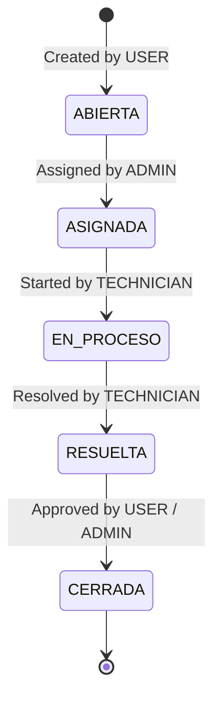

# TechNova IT Helpdesk

> **Comprehensive Incident Management, SLA Control, and IT Technical Support System**

<p align="left">
  
  
  
  
  
  
  
  
  
  
</p>

---

## 1. Project Context

**TechNova IT Helpdesk** is a centralized web platform designed to optimize and formalize the handling of technical support requests at **TechNova Solutions**.

* **Problem it solves:** Eliminates the fragmented and informal recording of incidents (informal channels such as email or messaging without traceability), preventing lost requests, uncontrolled delays, and a lack of operational metrics.
* **Technical solution:** Implements a strict workflow governed by a **state machine**, response-time controls based on **priority-specific SLAs**, administrator-supervised assignment, full auditing, and integration with analytical dashboards.

#### Demo: [TechNovaVideo1.0.mp4 - Google Drive](https://drive.google.com/file/d/1faXvxssYdiEFrVovwQjpUbP7ON19MeMl/view?usp=sharing)

---

## 2. Technologies and Versions

| Layer / Module    | Technology / Tool                                                                                                                                                                                                                                                                                                          | Versión        | Purpose                                                                                    |
|:----------------- |:-------------------------------------------------------------------------------------------------------------------------------------------------------------------------------------------------------------------------------------------------------------------------------------------------------------------------- |:-------------- |:------------------------------------------------------------------------------------------ |
| **Lenguaje**      |  **Java**                                                                                                                                                                                      | `21 (LTS)`     | Primary backend language with support for Virtual Threads.                                 |
| **Framework**     |  **Spring Boot**                                                                                                                                                              | `4.1.1`        | Application core, configuration, and dependency injection.                                 |
| **Seguridad**     |  **Spring Security** +  **JJWT**  | `0.12.6`       | Stateless authentication using JWT tokens and RBAC access control.                         |
| **Persistencia**  |  **Spring Data JPA** / **Hibernate**                                                                                                                                               | Integrada      | Object-relational mapping and optimized queries.                                           |
| **Base de Datos** |  **PostgreSQL**                                                                                                                                                                 | `15+`          | Relational database engine with indexes and constraints.                                   |
| **Build Tool**    |  **Gradle** (Wrapper)                                                                                                                                                                       | `9.7.1`        | Build automation and dependency management.                                                |
| **Documentación** |  **SpringDoc OpenAPI**                                                                                                                                                                   | `2.8.5`        | Interactive Swagger UI documentation and OpenAPI 3 specification.                          |
| **Frontend**      |   **Lumina Desk (Tailwind + ES6 Modules)** | `2.0 (Lumina)` | New front-end suite based on Lumina Support tokens, modular and connected to the REST API. |

---

## 3. Test Credentials

The database includes preconfigured seed accounts with passwords hashed using **BCrypt** (`admin123`):

| Role           | Email Address          | Contraseña | Scope and Permissions                                                                        |
|:-------------- |:---------------------- |:---------- |:-------------------------------------------------------------------------------------------- |
| **ADMIN**      | `admin@technova.com`   | `admin123` | Full system control, manual ticket assignment to technicians, metrics, and global dashboard. |
| **TECHNICIAN** | `tecnico@technova.com` | `admin123` | Management of assigned tickets, operational status progression, and technical comments.      |
| **USER**       | `usuario@technova.com` | `admin123` | Incident creation, tracking of their own requests, and closure confirmation.                 |

---

## 4. Main Entities

The data model is structured around the following key entities:

```
[UserAccount] 1 ──── * [Ticket] * ──── 1 [Category]
      │                   │ *
      │                   ├──── 1 [Priority]
      │ *                 ├──── 1 [TicketStatus]
[UserRole]                ├──── * [Comment]
      │ *                 ├──── * [TicketAssignment]
    [Role]                └──── * [TicketHistory]
```

* **`UserAccount`**: Represents system users (first name, last name, unique email, password hash, active status).
* **`Role` y `Permission`**: RBAC model with a many-to-many relationship for granular privilege control.
* **`Ticket`**: Core entity containing a title, description, requester, category, priority, and current status.
* **`Category`**: Incident classification (`HARDWARE`, `SOFTWARE`, `NETWORKS`, `ACCESS`, `OTHER`).
* **`Priority`**: Criticality level (`LOW`, `MEDIUM`, `HIGH`, `CRITICAL`) associated with the SLA time limit.
* **`TicketStatus` y `StatusTransition`**: Status catalog and relational matrix that validates which transitions are permitted.
* **`TicketAssignment`**: Historical record of technician assignments to tickets, including the date and assigner.
* **`Comment`**: Bidirectional feedback thread between the user and technician within the ticket.
* **`TicketHistory`**: Immutable audit record for each status change, including the actor and timestamp.

---

## 5. Lifecycle Flow and SLAs

### Strict State Machine

The ticket lifecycle does not allow arbitrary status transitions:



### Maximum SLA Times by Priority

* **CRITICAL:** Maximum SLA of **1 hour** (incidents that halt operations).
* **HIGH:** Maximum SLA of **2 hours** (severe impact on key processes).
* **MEDIUM:** Maximum SLA of **8 hours** (partial operational impact).
* **LOW:** Maximum SLA of **24 hours** (questions or minor failures).

---

## 6. API Documentation (Swagger UI)

Once the backend server is running, the interactive Swagger UI interface and the OpenAPI specification are publicly available at:

* **Swagger UI (Interactive):** [http://localhost:8080/swagger-ui/index.html](http://localhost:8080/swagger-ui/index.html)
* **OpenAPI Docs (JSON):** [http://localhost:8080/v3/api-docs](http://localhost:8080/v3/api-docs)

> **Instructions for testing protected endpoints in Swagger:**
> 
> 1. Send a request to `POST /api/auth/login` con cualquiera de las credenciales de prueba.
> 2. Copy the `token` value returned in the response JSON.
> 3. Click the **Authorize** button (upper-right corner of Swagger UI) and enter: `Bearer <tu_token>`.

---

## 7. Project Setup and Execution

### Prerequisites

* **Java 21 JDK** installed and configured in the environment variables (`JAVA_HOME`).
* **PostgreSQL 15+** running locally or remotely.
* Modern web browser with JavaScript ES6+ support.

---

### Step 1: Configure the PostgreSQL Database

1. Connect to the PostgreSQL client (`psql`, pgAdmin, or DBeaver) and create the database:
   
   ```sql
   CREATE DATABASE "TechNovaTest";
   ```

2. Run the seed DDL and DML script located at:
   
   ```text
   project/src/main/resources/technova_schema_and_data.sql
   ```
   
   *(This script initializes the schema, indexes, roles, permissions, and test users with their hashed passwords).*

---

### Step 2: Run the Backend (Spring Boot)

1. Open a terminal in the directory `project`:
   
   ```bash
   cd project
   ```

2. If PostgreSQL uses credentials other than the defaults (`admin` / `admin123`), adjust the environment variables or edit `src/main/resources/application.yaml`:
   
   ```yaml
   spring:
     datasource:
       url: jdbc:postgresql://localhost:5432/TechNovaTest
       username: tu_usuario
       password: tu_password
   ```

3. Build and run the application using the Gradle Wrapper:
   
   * **Windows (PowerShell / CMD):**
     
     ```powershell
     .\gradlew.bat bootRun
     ```
   
   * **Linux / macOS:**
     
     ```bash
     ./gradlew bootRun
     ```

4. The backend will start on port `8080` (`http://localhost:8080`).

---

### Step 3: Run the Frontend (Port 5050)

The **Lumina Desk** frontend uses a modular **Vanilla ES6 + CSS3 Tokens** architecture and is optimized to run on port **`5050`** using the VS Code **Live Server** extension or local scripts:

* **Option A (Recommended - Windows script on port 5050):**
  Run the script from the repository root:
  
  ```cmd
  iniciar_frontend.bat
  ```
* **Option B (VS Code Live Server on port 5050):**
  1. Open the `frontend/` folder in VS Code.
  2. Verify that the Live Server setting (`liveServer.settings.port`) is set to `5050`.
  3. Right-click `frontend/index.html` > *Open with Live Server*.
* **Option C (Node.js / npx on port 5050):**
  
  ```bash
  npx http-server frontend -p 5050 -c-1 --cors
  ```
* **Option D (Python on port 5050):**
  
  ```bash
  python -m http.server 5050 --directory frontend
  ```

Navigate to: `http://localhost:5050/index.html`.

---

## 8. Main API Endpoints (Spring Boot REST)

| Method | Endpoint                     | Required Access                 | Description                                                                  |
|:------:|:---------------------------- |:-------------------------------:|:---------------------------------------------------------------------------- |
| `POST` | `/api/auth/login`            | Public                          | Email/password authentication and JWT token response.                        |
| `POST` | `/api/auth/register` (o `/register`) | `ADMIN`                 | Registro de nuevos técnicos (TECHNICIAN) y usuarios (USER) por Administrador. |
| `GET`  | `/api/auth/me`               | Authenticated                   | Retrieves the authenticated user's profile, including roles and permissions. |
| `GET`  | `/api/tickets`               | Authenticated                   | Lists tickets with filters (USER can view their own; ADMIN can view all).    |
| `POST` | `/api/tickets`               | `USER` / `ADMIN`                | Creates a new support request with an automatically assigned SLA.            |
| `GET`  | `/api/tickets/{id}`          | Authenticated                   | Full ticket details, including requester, technician, and SLA.               |
| `PUT`  | `/api/tickets/{id}/assign`   | `ADMIN`                         | Manual assignment or reassignment of the responsible technician.             |
| `PUT`  | `/api/tickets/{id}/status`   | `TECHNICIAN` / `ADMIN` / `USER` | Status change governed by the strict state machine.                          |
| `GET`  | `/api/tickets/{id}/comments` | Authenticated                   | Lists ticket comments and resolution notes.                                  |
| `POST` | `/api/tickets/{id}/comments` | Authenticated                   | Records comments and technical responses (maximum 2,000 characters).         |
| `GET`  | `/api/tickets/{id}/history`  | Authenticated                   | Immutable audit log of status transitions.                                   |
| `GET`  | `/api/users/technicians`     | `ADMIN`                         | Catalog of active technicians available for assignment.                      |
| `GET`  | `/api/admin/dashboard`       | `ADMIN`                         | Global executive metrics, SLA compliance, and workload.                      |
| `GET`  | `/api/categories`            | Authenticated                   | Dynamic catalog of active categories.                                        |
| `GET`  | `/api/priorities`            | Authenticated                   | Dynamic catalog of priorities and SLA time limits.                           |

---

## 9. Repository Structure

```text
TechNova-IT-Helpdesk/
├── frontend/                     # Vanilla JS web application (Lumina Desk SPA)
│   ├── css/
│   │   ├── variables.css         # Design tokens, color variables, and iconography
│   │   ├── base.css              # CSS reset, Plus Jakarta Sans / JetBrains Mono typography
│   │   ├── layout.css            # Responsive shell, mobile drawer, and top bar
│   │   ├── components.css        # KPI cards, tables, badges, modals, and spinners
│   │   └── pages.css             # View styles and print support (@media print)
│   ├── js/
│   │   ├── config.js             # Constants and API endpoint catalog
│   │   ├── session.js            # JWT handling in localStorage, decoding, and RBAC
│   │   ├── api.js                # Universal HTTP client with JWT interceptor and ApiError
│   │   ├── ui.js                 # Toast notifications, date formatting, SLA calculation, and XSS escaping
│   │   ├── app.js                # Global initializer, keyboard shortcuts, and network detector
│   │   ├── auth.js               # Login controller
│   │   ├── dashboard.js          # Live operational metrics and recent tickets table
│   │   ├── tickets.js            # Reactive catalog, multi-criteria search, and pagination
│   │   ├── ticket-detail.js      # Ticket details, state machine, and comments
│   │   ├── reportes.js           # Executive metrics and technician distribution (ADMIN)
│   │   ├── session.test.js       # Unit test suite for sessions and RBAC permissions
│   │   ├── api.test.js           # Unit test suite for the HTTP client
│   │   └── ui.test.js            # Unit test suite for utilities and SLA
│   ├── index.html                # Login view
│   ├── dashboard.html            # Real-time operations dashboard
│   ├── tickets.html              # Incident directory and comprehensive management
│   ├── ticket-detail.html        # Ticket details, transitions, and auditing
│   ├── reportes.html             # Executive analytics (ADMIN only)
│   └── tests.html                # Interactive browser-based unit test suite
├── project/                      # Spring Boot backend (Java 21)
│   ├── src/main/java/tech/com/project/
│   │   ├── controller/           # REST API controllers
│   │   ├── model/                # Domain JPA entities
│   │   ├── repository/           # Spring Data JPA repositories
│   │   ├── security/             # JWT and Spring Security configuration
│   │   └── service/              # Business logic and state machine
│   ├── src/main/resources/
│   │   ├── application.yaml      # Properties and data source configuration
│   │   └── technova_schema_and_data.sql # Initial SQL script (DDL + seed data)
│   ├── build.gradle              # Dependencias y configuración Gradle
│   └── gradlew / gradlew.bat     # Wrapper de Gradle
├── iniciar_frontend.bat          # Automatic frontend launcher on port 5050
├── media/                        # Project screenshots and visual evidence
├── ERS TechNova.md               # Formal Software Requirements Specification
└── README.md                     # Main project documentation
```

---

## Team and Credits

* **Leader:** Ing. Cristian Díaz
* **Development and Architecture:** Santiago Andrés Sarmiento Martínez
* **Front-end:** Fabio Daniel Capacho Nuñez
* **API Development and Integration:** Jason Ferney Pallares Duque y Brayan Fonxeca
* **Organization:** TechNova Solutions


---

## Registro Administrativo de Usuarios (/register)

Se implementó el endpoint administrativo de registro de usuarios restringido exclusivamente al rol `ADMIN`, permitiendo crear cuentas de técnicos (`TECHNICIAN`) y usuarios finales (`USER`).
* **Archivos modificados y creados:**
  * `UserRegisterRequestDto.java`: DTO de validación para nombres, correo, contraseña y rol.
  * `AuthService.java` y `AuthServiceImpl.java`: Lógica de validación de unicidad de correo, encriptación BCrypt y restricción de roles permitidos.
  * `AuthController.java`: Endpoint REST `@PostMapping("/register")` (disponible en `/register` y `/api/auth/register`) con `@PreAuthorize("hasRole('ADMIN')")`.
  * `UserRegisterTest.java`: Pruebas de integración automatizadas.

